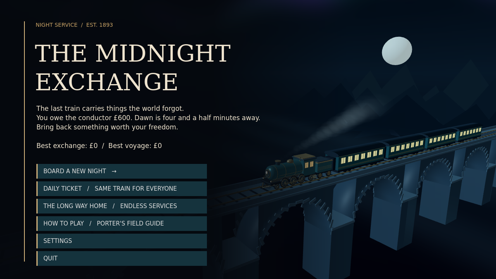
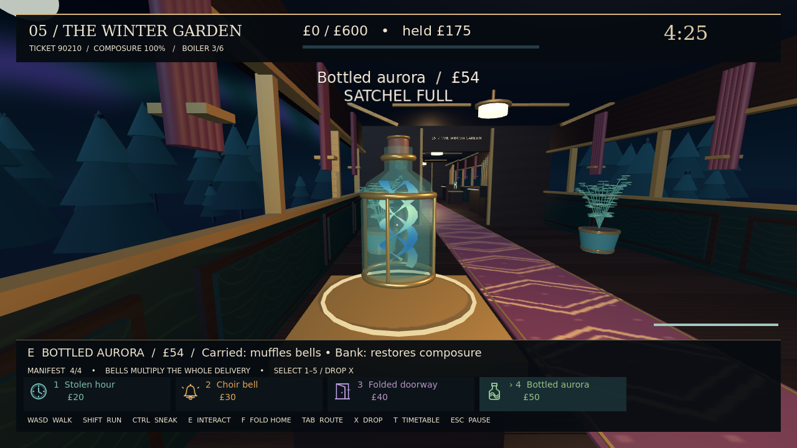

# The Midnight Exchange

A native 3D game about impossible freight on the last train before dawn. Built in Godot 4.6.3 for Windows 10/11 (x64); a Linux build is also available.



You owe the conductor £600. Explore seven art-deco carriages, decide which relics fit in your satchel, and bring them back to the exchange. Bells multiply carried freight but attract attention. Stolen hours buy time. A folded doorway can save a long walk home. The timetable lever moves the last carriage to the front—along with whatever, or whoever, is inside. Shunt neighboring carriages to awaken resonance bonuses, or play the choir's organ to draw the conductor away.

Four passenger commissions trade your tools for sealed fares and a different dawn. Win after helping them to keep their first-morning stories in the porter's notebook across later tickets. An escalating endless-service mode tracks your whole voyage.



[Passing villages beyond the carriage windows](docs/screenshots/window-view.png) · [Planning at the switchboard](docs/screenshots/switchboard.png) · [The choir's one voice](docs/screenshots/choir.png) · [The porter's notebook](docs/screenshots/notebook.png).

## Playing

Verified development ZIPs are attached to successful [native build runs](https://github.com/ShibaInKyoto/AIvsAI-Game-Comp-2-GPT/actions/workflows/build.yml). The final competition build will also appear in Releases. Download the Windows ZIP, extract it, and open **TheMidnightExchange.exe**. The game is standalone: no browser, engine installation, account, network connection or paid asset is required. Read [the player guide](PLAYER_GUIDE.md) for controls and strategies.

## Development

Use Godot **4.6.3 stable**, standard edition (no .NET required). Open `project.godot` in the editor, or run `godot --path .`.

```sh
# If Godot/templates are missing, download official checksum-verified binaries:
python3 scripts/bootstrap_godot.py
export GODOT_BIN="$PWD/.tools/godot"
# Otherwise the validator uses godot on PATH:
scripts/validate.sh
mkdir -p build/windows
godot --headless --path . --export-release Windows build/windows/TheMidnightExchange.exe
```

In restricted cloud filesystems, set `XDG_DATA_HOME`, `XDG_CONFIG_HOME`, and `XDG_CACHE_HOME` to writable directories before invoking Godot. The development environment uses `/workspace/.runtime/{data,config,cache}`.

## Organization

- `game/main.gd`: input, physics, interactions, scene composition, save handling.
- `game/run_state.gd`: independent economy and run simulation.
- `game/train.gd`: procedural carriage architecture, scenery and timetable.
- `game/freight.gd`, `passenger.gd`, `conductor.gd`: relics, commissions and threat behavior.
- `game/organ.gd`: the choir's single-use conductor diversion.
- `game/satchel.gd`: the porter's camera-local bag, glove and selected relic.
- `game/dawn.gd`: the real-time station epilogue.
- `game/title_scene.gd`: the locomotive and viaduct title tableau.
- `game/profile.gd`: validated, replace-on-success settings and records.
- `game/interface.gd`, `sound.gd`: scalable UI, carriage ambience and the night-to-dawn score.
- `assets/`: original modeled props/relics, generated textures/audio, DejaVu fonts and engine notices.
- `tests/`: simulation invariants; integration tests also exercise the running scene.
- `scripts/`: reproducible asset generation (including optional Blender 4.3 modeling), verified tool installation, validation.

Pushes build downloadable native artifacts. Version tags run both Linux and native Windows tests before GitHub Actions publishes a release. See [design and progress](docs/DESIGN.md).

For an optional live-conductor balance diagnostic, run `godot --headless --fixed-fps 120 --path . --script scripts/assess_live.gd -- --qa-seed=20261029`. This porter knows the freight layout and uses ordinary movement, cover, folding and timetable costs. It changes no threat or economy rules. A failed heuristic run does not establish that a ticket is unwinnable; this diagnostic is separate from the deterministic build checks.

An optional Linux input check runs the exported executable through OS keyboard and mouse events: `python3 scripts/assess_native_input.py build/linux/TheMidnightExchange.x86_64 --display :99`. Use a dedicated X11 display with libX11, libXtst, `xprop` and `xwininfo` available. It creates an isolated profile and preserves screenshots, a log and a JSON result in a fresh temporary directory. The opt-in `--input-observer` reports game state without supplying actions or changing rules. The check boards, collects and banks one relic, upgrades, shunts, reads the ledger and quits through the menus. This is a short input-path check, not a full-run balance or FPS test. `--checkpoint-rendering` can reduce drawing on slow software displays; continuous rendering is the default.

Optional asset regeneration uses Blender 4.3: `blender --background --python scripts/model_props.py`, `scripts/model_relics.py`, `scripts/model_satchel.py`, `scripts/model_organ.py`, or `scripts/model_locomotive.py`. The generators share `scripts/modeling.py`. The fern can also be regenerated alone with `blender --background --python scripts/model_fern.py`. Blender is not needed to build or play the game.

`python3 scripts/generate_audio.py` rebuilds the original score, effects and carriage ambience using the Python standard library. `scripts/generate_ambience.py` can rebuild just the room loops and morning theme.
